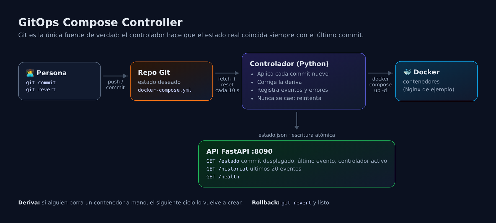

# 🔁 GitOps Compose Controller

Controlador **GitOps** escrito en Python que mantiene un entorno de **Docker Compose** sincronizado con un repositorio Git.
**Git es la única fuente de verdad**: para cambiar algo en el entorno no se toca el servidor, se hace un commit.

Es la misma idea que usan Argo CD o Flux en Kubernetes, aplicada a Docker Compose: local, reproducible y sin coste.

<!-- CAPTURAS -->

## 🚀 ¿Qué problema resuelve?

En muchos entornos los cambios se aplican a mano, no queda constancia de quién cambió qué y el estado real acaba
siendo distinto del esperado. Con GitOps:

- **Git define el estado deseado** y guarda el historial de cada cambio.
- **Un controlador lo aplica** y vigila que el estado real no se desvíe.
- **Volver atrás es un `git revert`.**

## 🧠 Filosofía

- No es una aplicación web: **Git es la interfaz** y la terminal es el panel de control.
- Una **API REST** expone qué está desplegado, los eventos recientes y los errores.
- Es el enfoque de herramientas como Terraform, Flux o Argo CD.

## 🧱 Arquitectura



## ✨ Qué hace

- **Bucle de reconciliación**: cada `INTERVALO_SEGUNDOS` sincroniza el repo del estado deseado.
- **Aplica cada commit nuevo** con `docker compose up -d --remove-orphans`.
- **Corrige la deriva**: si alguien para o borra un contenedor a mano, en el siguiente ciclo lo vuelve a levantar y lo registra.
- **Git siempre manda**: usa `fetch` + `reset` al remoto, así que no se bloquea si alguien reescribe el historial (`push --force`) ni si se toca la copia local.
- **Nunca se cae**: los errores se registran y se reintenta en el siguiente ciclo.
- **Historial** de los últimos 20 eventos (aplicaciones, deriva corregida y errores), sin repetir el mismo error en cada ciclo.
- **Estado consistente**: el fichero de estado se escribe de forma atómica, así la API nunca lee un JSON a medias.
- **Detecta si el controlador se ha parado**: la API marca `controlador_activo: false` si lleva más de tres ciclos sin actualizar el estado.

## 🛠️ Tecnologías

Python 3.11 · FastAPI · Uvicorn · Git · Docker · Docker Compose v2 · pytest · GitHub Actions · Make · Bash

## 📁 Estructura

```
controller/
├── main.py          # Bucle de reconciliación
├── git_sync.py      # clone / fetch + reset / commit actual
├── reconciler.py    # docker compose up / ps y detección de deriva
├── state_store.py   # Estado e historial en JSON (escritura atómica)
├── config.py        # Configuración por variables de entorno
├── api.py           # API FastAPI
└── tests/           # Tests con repos Git reales y Docker simulado
env-repo-example/    # Plantilla del repo del estado deseado
scripts/             # Bootstrap del repo y ejecución sin Docker
```

## ▶️ Puesta en marcha

Requisitos: Docker con Docker Compose v2, Git y Make. No hace falta Kubernetes.

```bash
make up          # crea el repo del estado deseado (la primera vez) y levanta controlador + API
make estado      # qué está desplegado ahora
make historial   # últimos eventos
make down
```

El primer `make up` ejecuta `make bootstrap`, que crea `repos/estado-deseado/` como repo Git local a partir de
`env-repo-example/`: un Nginx de ejemplo en el puerto **8085**.

| | URL |
|---|---|
| API | http://localhost:8090 |
| Documentación interactiva (Swagger) | http://localhost:8090/docs |
| Servicio de ejemplo | http://localhost:8085 |

## 🔄 Uso GitOps

### Cambiar el entorno con un commit

```bash
make cambiar-puerto PUERTO=8099
```

Modifica el `docker-compose.yml` del repo del estado deseado y hace commit. En unos segundos el controlador detecta
el commit y recrea el contenedor: el Nginx pasa a responder en http://localhost:8099 sin haber tocado Docker.

### Volver atrás (rollback)

```bash
cd repos/estado-deseado
git revert --no-edit HEAD
```

El controlador aplica automáticamente el estado anterior.

### Corrección de deriva

```bash
make limpiar-web   # borra el contenedor a mano, "saltándose" Git
make historial     # en el siguiente ciclo aparece "Deriva corregida"
```

## 📡 API

| Ruta | Descripción |
|---|---|
| `GET /health` | La API responde |
| `GET /estado` | Commit aplicado y su mensaje, última aplicación, último evento y error, servicios desplegados (nombre, imagen, estado y puertos) y si el controlador sigue activo. `503` si el controlador aún no ha escrito su estado |
| `GET /historial` | Últimos 20 eventos |

## ⚙️ Configuración

| Variable | Por defecto | Descripción |
|---|---|---|
| `URL_REPO_ESTADO_DESEADO` | — | Ruta o URL del repo Git con el estado deseado |
| `RUTA_REPO_LOCAL` | `../repos/_clonado_estado_deseado` | Dónde clona el controlador ese repo |
| `INTERVALO_SEGUNDOS` | `10` | Cada cuánto reconcilia |
| `ARCHIVO_ESTADO` | `estado.json` | Fichero de estado compartido con la API |

Para usar un repo remoto (GitHub, GitLab…) basta con poner su URL en `URL_REPO_ESTADO_DESEADO`.

## 🧪 Calidad

```bash
make test
```

Los tests usan **repositorios Git reales** en carpetas temporales (commits nuevos, `push --force`, cambios a mano en la
copia local) y simulan solo Docker, así que se ejecutan sin Docker. GitHub Actions ejecuta los tests, valida el
`docker-compose.yml`, construye la imagen y comprueba que lleva Docker Compose v2.

## 🔐 Nota de seguridad

El controlador monta `/var/run/docker.sock` para poder ejecutar Docker Compose en el host. Eso le da control total
sobre Docker, igual que a cualquier herramienta de despliegue: en un entorno real solo debe apuntar a repos de confianza.

## 📚 Qué he aprendido

- El patrón de **reconciliación** (estado deseado frente a estado real) que hay detrás de Kubernetes, Argo CD y Flux.
- Diseñar un proceso **idempotente** que no se cae ante errores y que no se bloquea por el historial de Git.
- Compartir estado entre procesos de forma segura (escritura atómica) y detectar cuándo uno de ellos deja de funcionar.
